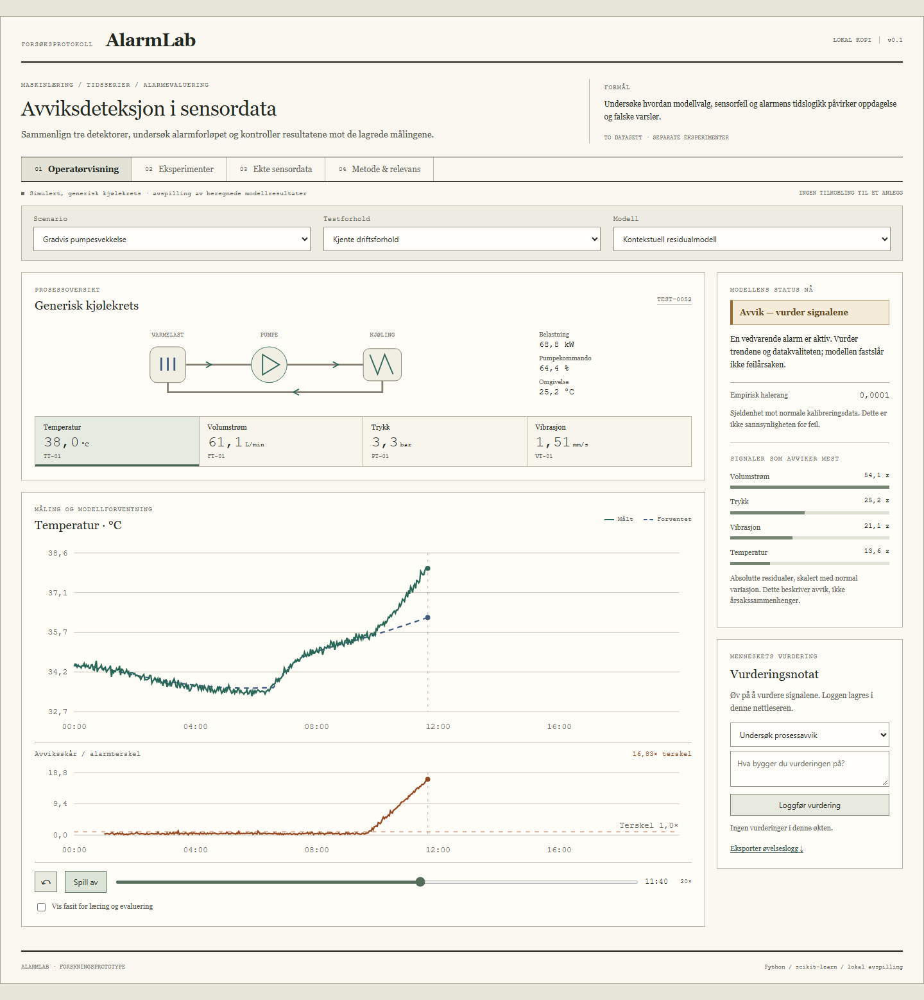
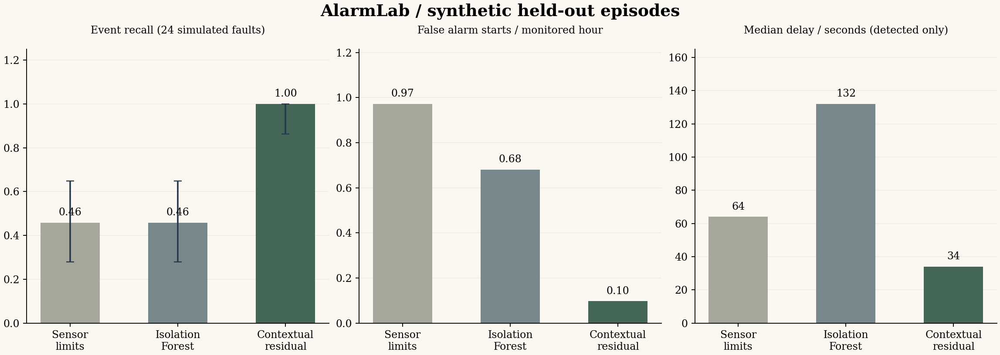

# AlarmLab

A reproducible study of anomaly scores, alarm timing and data quality.

AlarmLab is a research portfolio about anomaly monitoring, alarm behaviour and human judgement. A detector that stays in alarm can score well on anomalous samples while failing to signal a new event. This project makes that distinction visible.

It combines a generic cooling-loop simulator, three normal-only detectors, a measured hydraulic-sensor benchmark, and an offline interface for reviewing model evidence. The methodological starting point is medical data science: separate subjects or runs, account for correlated measurements, measure false alarms, and distinguish an empirical anomaly rank from a calibrated probability.

**[Norwegian start guide](START_HER.md) · [Results](artifacts/RESULTS.md) · [Project story](docs/PROJECT_STORY.md) · [Methods](docs/METHODS.md)**



## What is actually implemented

- A seeded simulator with normal operation, legitimate load changes, three process/sensor anomalies, missing measurements and frozen readings.
- Robust sensor limits, Isolation Forest, and a conditional Ridge model whose standardized residuals provide an interpretable anomaly score.
- Disjoint episode-level training, calibration and test sets; strictly causal features; empirical threshold calibration; missing-data and operating-context gates.
- A persistent alarm state machine with hysteresis, evaluated using new-event recall, detection delay, false starts per monitored normal hour, alarm occupancy and coverage.
- Controlled noise and context shifts, an alarm-logic ablation, and uncertainty intervals using the appropriate episode/group unit.
- A separate supervised benchmark using 2,205 measured cycles from UCI 447, with 36 features and disjoint condition groups.
- A standalone HTML replay with scenario/model selection, signal trends, residual evidence, data-quality states, and a local assessment log.
- Source code, executable tests, generated results, a study protocol, decision records, an executed walkthrough notebook and reproducibility manifests.

No model inference or external service runs in the browser. The HTML replays the Python predictions that generated the tables.

## Findings worth discussing

The default synthetic experiment contains 148 episodes and 88,800 samples. Training uses 24 normal episodes, calibration uses 12, and the remaining 112 episodes form three held-out conditions.

| In-domain method | New events detected | False alarm starts / monitored normal hour | Median delay, detected events only |
|---|---:|---:|---:|
| Robust sensor limits | 11 / 24 | 0.972 | 64 s |
| Isolation Forest | 11 / 24 | 0.681 | 132 s |
| Contextual residual | 24 / 24 | 0.097 | 34 s |

The residual model's observed 24/24 recall has a 95% Wilson interval of approximately **86.2–100%**. These are simulated events, not evidence about real plant reliability.

**The main negative result:** under three times the sensor noise, the residual model produces 36 false alarm starts and detects **0/12 new events** with the strict onset-based definition. It can enter an alarm before the fault and remain there. The operating-context gate also abstains under an ambient-temperature shift, reducing model coverage to zero. Neither failure is hidden behind sample accuracy.

The hydraulic classification tasks are easy on the supplied rig: both fitted classifiers score 1.0 balanced accuracy on the grouped holdout. This is reported with the single-rig and split limitations, not advertised as a general failure-prediction capability. The pump task was added as an explicitly exploratory extension.



## Open the demo

Download the repository, then open **[demo/index.html](demo/index.html)** in a browser. It is one self-contained file; no installation, server, login, API key or network connection is required. GitHub's file view shows HTML source, so download/open the file locally.

Choose “Gradvis pumpesvekkelse”, then compare the residual model and Isolation Forest. Try “Stress: 3× sensorstøy” and “Manglende målinger”. The experimental-results view explains why those cases matter.

## Reproduce the research

Python 3.11 or newer. From the repository root:

```powershell
python -m venv .venv
.\.venv\Scripts\python.exe -m pip install -r requirements-tested.txt
.\.venv\Scripts\python.exe -m pip install --no-deps -e .
.\.venv\Scripts\python.exe -m unittest discover -s tests -v
.\.venv\Scripts\python.exe run.py all --output artifacts/rerun
```

On macOS/Linux, replace the interpreter path with `.venv/bin/python`. The Windows helper `scripts/run.ps1` also locates a local Python installation when the Windows Store alias is unusable.

The shipped derived UCI features make the full default experiment offline after dependencies are installed. To regenerate them from the original archive:

```powershell
python run.py download-uci --output data/raw/uci447.zip
python run.py extract-uci --archive data/raw/uci447.zip
python run.py all
```

The downloader checks the archive's SHA-256. Extraction reads only explicitly named files and does not unpack paths from the archive.

Additional verification:

```text
python scripts/create_notebook.py
python scripts/verify_artifacts.py
npm ci
npx playwright install chromium
npm run test:browser
```

The browser dependency is needed only for automated interface checks. The demo itself contains no JavaScript dependencies.

Local verification is complete. The supplied GitHub Actions workflow has not yet run remotely; see the [verification record](docs/VERIFICATION.md).

For isolated work use both `--output artifacts/my-run` and `--demo artifacts/my-run/demo`. The experiment output does not overwrite source data. Existing files inside a selected output directory are regenerated.

## Read the project in order

| Question | Document |
|---|---|
| Why this problem and how did the project develop? | [Project story](docs/PROJECT_STORY.md) |
| How is this related to medical data science? | [Medical data science](docs/MEDICAL_DATA_SCIENCE.md) |
| What are the exact models, features and metrics? | [Methods](docs/METHODS.md) |
| Why these choices instead of plausible alternatives? | [Decision records](docs/DESIGN_DECISIONS.md) |
| Where do the data come from? | [Data card](docs/DATA_CARD.md) |
| What can the model support? | [Model card](docs/MODEL_CARD.md) |
| How does every program module fit together? | [Architecture and API](docs/ARCHITECTURE.md) |
| What has been checked? | [Verification record](docs/VERIFICATION.md) |
| What failed and what would improve the evidence? | [Failure analysis](docs/FAILURE_ANALYSIS.md) |
| How would human usefulness be tested? | [Proposed human-factors study](docs/HUMAN_FACTORS_STUDY.md) |
| How do I present and extend it myself? | [Demo script](portfolio/DEMO_SCRIPT.md), [learning plan](portfolio/LEARNING_PLAN.md) |

## Relevance to IFE

The application is aligned with IFE's public work on applied data science, condition monitoring and human-system interaction. The most direct fit is **Applied Data Science (ADS)**, with methodological links to **Control Room and Interaction Design (CRI)**, **Human and Organisational Factors (HOF)** and **Risk & Safety (SAF-R)**. See the [source-to-project mapping](docs/SOURCES.md).

This is an independent portfolio project. It contains no IFE data, plant-specific model, clinical dataset or operational control integration. No human-factors experiment has been conducted.

## Authorship, data and licence

The initial implementation and documents were prepared with substantial AI assistance. [AI_ASSISTANCE.md](AI_ASSISTANCE.md) distinguishes implemented work, observed results and work the portfolio owner should perform personally before claiming independent experience.

Code: [MIT](LICENSE). The redistributed UCI-derived features retain **CC BY 4.0** attribution; see [THIRD_PARTY_NOTICES.md](THIRD_PARTY_NOTICES.md). The complete job advert and third-party website text are not redistributed.
