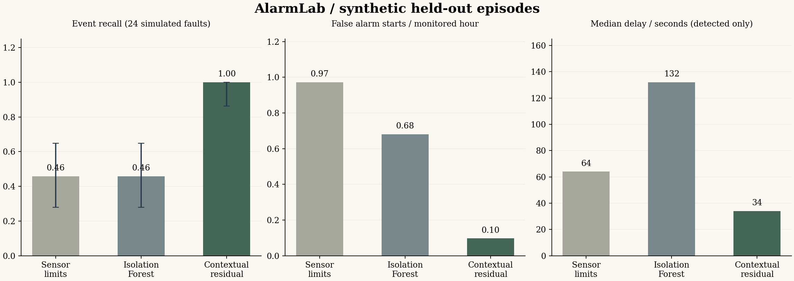
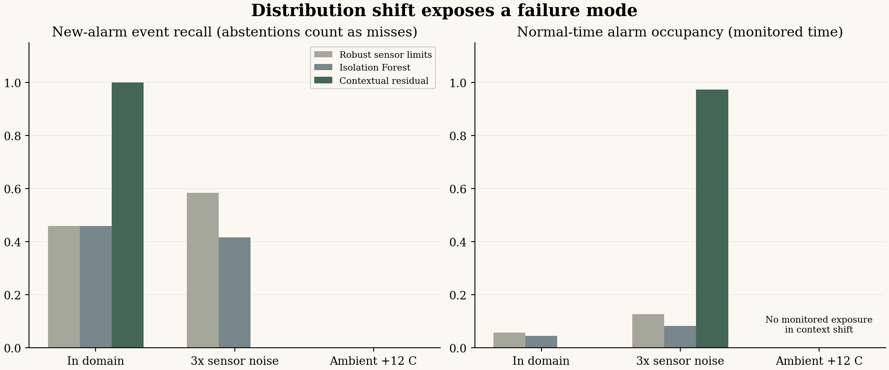

# Experimental results

Generated from saved predictions. All synthetic and real-data results below are separate experiments.

## Synthetic monitoring experiment

Seed: 20261109. 148 independent episodes; 88,800 samples; 2-second sampling.
Training and threshold calibration use separate normal episodes. Each held-out fault episode counts once.

| Domain | Method | Detected / events | Recall 95% Wilson CI | False starts / h | Delay s* | Coverage |
|---|---|---:|---|---:|---:|---:|
| in_domain | Robust sensor limits | 11 / 24 | [0.279, 0.649] | 0.972 | 64 | 82.7% |
| in_domain | Isolation Forest | 11 / 24 | [0.279, 0.649] | 0.681 | 132 | 82.7% |
| in_domain | Contextual residual | 24 / 24 | [0.862, 1.000] | 0.097 | 34 | 82.7% |
| noise_shift | Robust sensor limits | 7 / 12 | [0.320, 0.807] | 1.573 | 66 | 82.4% |
| noise_shift | Isolation Forest | 5 / 12 | [0.193, 0.680] | 0.983 | 82 | 82.4% |
| noise_shift | Contextual residual | 0 / 12 | [0.000, 0.242] | 7.080 | not available | 82.4% |
| context_shift | Robust sensor limits | 0 / 12 | [0.000, 0.242] | not available | not available | 0.0% |
| context_shift | Isolation Forest | 0 / 12 | [0.000, 0.242] | not available | not available | 0.0% |
| context_shift | Contextual residual | 0 / 12 | [0.000, 0.242] | not available | not available | 0.0% |

*Median delay is conditional on detection. Missed events remain in the recall denominator.
False alarm exposure excludes warmup and abstentions. An unavailable rate means no monitored exposure, not zero false alarms.

## The negative result matters

The residual model is closely matched to the synthetic generator. Its strong in-domain performance is not evidence of superiority on physical plants.
Under 3x sensor noise, it can latch into an alarm before a fault starts. A pre-existing alarm does not count as detecting a new event. Read event recall together with normal alarm occupancy and the complete traces.
The context gate abstains when ambient temperature is shifted outside training bounds. Abstained fault episodes count as missed in end-to-end recall. Abstention is not successful anomaly detection.
Noise monitoring, revised alarm reset logic and adaptive calibration are future hypotheses; they have not been silently added to improve these held-out numbers.

## Real hydraulic sensor benchmark

2205 measured 60-second cycles and 36 derived features. Fixed threshold: 0.5.
Split sizes: {'train': 1545, 'calibration': 285, 'test': 375}. Condition-group counts: {'train': 81, 'calibration': 27, 'test': 36}.
The 'calibration' split is a validation set in this supervised experiment; no probability calibration or model selection was performed.

| Target | Model | Test balanced accuracy | Group-bootstrap 95% CI | Macro F1 | ROC AUC | TN / FP / FN / TP |
|---|---|---:|---|---:|---:|---|
| cooler_degradation | dummy_prior | 0.500 | [0.500, 0.500] | 0.422 | 0.500 | [0, 101, 0, 274] |
| cooler_degradation | logistic_regression | 1.000 | [1.000, 1.000] | 1.000 | 1.000 | [101, 0, 0, 274] |
| cooler_degradation | random_forest | 1.000 | [1.000, 1.000] | 1.000 | 1.000 | [101, 0, 0, 274] |
| pump_leakage | dummy_prior | 0.500 | [0.500, 0.500] | 0.313 | 0.500 | [171, 0, 204, 0] |
| pump_leakage | logistic_regression | 1.000 | [1.000, 1.000] | 1.000 | 1.000 | [171, 0, 0, 204] |
| pump_leakage | random_forest | 1.000 | [1.000, 1.000] | 1.000 | 1.000 | [171, 0, 0, 204] |

The cooler task is easy on this rig. A perfect observed test score and a degenerate [1,1] bootstrap interval are not proof of perfect future performance.
Pump leakage is an exploratory extension added after seeing the easy cooler result. It is reported as exploratory, not as confirmatory evidence.
The random-row diagnostic shares 139 condition recipes across train/test and gives cooler balanced accuracy 1.000. It is a weaker split design even if its score matches the grouped result.

Limitations: one rig, no independent deployment site, no guaranteed session independence, no early-warning labels. Raw virtual efficiency channels are excluded.

## Reproduction and provenance

Run python run.py all --output artifacts/rerun. Compare configuration, event counts and hashes in the manifests. Exact floats can vary across library/platform versions.
The distributed environment versions are in manifest.json and requirements-tested.txt.
Source and data fingerprints in the manifest identify the run; rerun after edits before describing results as current.

Sources: [UCI 447](https://doi.org/10.24432/C5CW21), [scikit-learn data leakage guidance](https://scikit-learn.org/stable/common_pitfalls.html).
