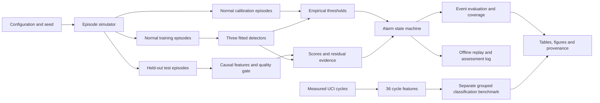

# Architecture and program reference

## End-to-end flow



The synthetic and measured-data paths meet in reporting, not in training. The interface contains precomputed arrays; it does not reimplement Python model logic in JavaScript.

## Repository map

```text
configs/default.json              Default experiment specification
src/alarmlab/                     Python package
tests/test_core.py                Numerical, causal and integration checks
tests/browser.spec.cjs            Browser interaction and offline checks
src/alarmlab/web/                 Packaged HTML, CSS and JavaScript source
demo/index.html                  Generated single-file replay
data/external/                   UCI-derived table and attribution manifest
artifacts/                       Saved observations, predictions and reports
notebooks/01_research_walkthrough.ipynb
docs/                            Methods, decisions and limitations
portfolio/                       Demo, application and learning notes
scripts/                         Local run, notebook and verification helpers
```

## Module contracts

| Module | Responsibility | Important functions/classes |
|---|---|---|
| config.py | Validate explicit experiment settings | Config, Config.read |
| simulator.py | Generate seeded independent episodes and annotations | simulate_run, make_dataset |
| features.py | Validate schema, calculate causal input features and quality reasons | validate_frame, causal_features, quality_reasons, warmup_mask |
| models.py | Fit three detectors, calibrate thresholds and expose sensor evidence | DetectorSuite.fit/score/predict, empirical_tail |
| alarms.py | Convert scores into time-dependent states | alarm_states |
| evaluation.py | Define event units and aggregate metrics | event_table, aggregate_events, add_point_metrics, wilson_interval |
| experiment.py | Orchestrate the synthetic pipeline and write provenance | run_experiment |
| benchmark.py | Download/check source data, extract cycle summaries and fit grouped classifiers | download_archive, extract_features, split_cycles, run_benchmark |
| reporting.py | Generate figures, results text and standalone replay | build_reports, build_demo |
| io.py | Deterministic compressed CSV, strict JSON and SHA-256 | write_csv_gz, write_json, sha256 |
| cli.py | Explicit command-line entry points | main |

## Public Python usage

```python
from alarmlab.config import Config
from alarmlab.simulator import make_dataset
from alarmlab.models import DetectorSuite

cfg = Config()
data = make_dataset(cfg)
model = DetectorSuite(cfg).fit(
    data[data.split == "train"],
    data[data.split == "calibration"],
)
test_predictions = model.predict(data[data.split == "test"])
```

Fit must precede predict. Calibration and training run IDs must be disjoint. Fit rejects known fault annotations in those partitions. score exposes raw inference output; predict adds per-episode alarm states. The returned frame retains supplied metadata for evaluation.

The suite is an in-memory research object. A deployed serialization format, streaming service and model registry are deliberately outside this release. Reproduction refits from the deterministic inputs.

## Input schema and validation

Required columns are run_id, time_s, the four names in simulator.SENSORS and the three in simulator.CONTEXT. Numeric NaNs are allowed as observations so that the quality gate can represent missingness.

Within a run, timestamps must be strictly ordered at two-second intervals. Duplicate timestamps, non-numeric channels, nonfinite timestamps, empty data, missing identifiers and duplicate DataFrame indices are rejected. A function does not silently reorder an invalid stream.

The model's score feature lists are explicit. Additional annotation columns cannot become predictors through a broad “all numeric columns” selection.

## Prediction schema

All detector names use prefixes: raw_limits, isolation_forest, contextual_residual.

| Column family | Meaning |
|---|---|
| eligible | All eligibility checks pass and required inference inputs are finite |
| warmup | Observation lies inside the episode's first 30 samples |
| quality_reason | Empty string, missing_or_nonfinite, outside_physical_range, stuck_sensor or unsupported_context |
| expected_SENSOR | Conditional sensor prediction plus training residual median offset |
| residual_z_SENSOR | Absolute standardized residual evidence |
| METHOD_score | Nonnegative rarity score; NaN when ineligible |
| METHOD_tail_rank | Empirical rank against held-out normal calibration scores |
| METHOD_status | WARMUP, REVIEW, NORMAL, WATCH or ALARM |
| METHOD_alarm_start | True only at a new transition into ALARM |

Expected values can be computed internally on finite but unsupported data. The demo masks those expectations and explanations when quality/context checks fail. Warmup may have an internal score, but the demo does not display it as a decision.

## Files produced by a full run

| File | Contents |
|---|---|
| synthetic_observations.csv.gz | All synthetic train/calibration/test observations |
| predictions.csv.gz | Every synthetic test observation and all model outputs |
| event_metrics.csv | One row per test episode and detector |
| scenario_metrics.csv | Scenario-level counts, delay and coverage |
| synthetic_summary.json | Aggregate metrics, thresholds, gate limits and alarm ablation |
| real_benchmark_predictions.csv.gz | UCI split assignments, ground-truth labels and held-out class scores |
| real_benchmark.json | Split sizes, metrics, uncertainty and limitations |
| manifest.json | Settings, software versions, episode IDs, code/data hashes |
| RESULTS.md and figures/ | Rebuilt human-readable report |
| demo/index.html | Standalone result replay |

The manifest fingerprints the numerical source modules. The release verification file additionally records the test outcome. File timestamps and plot renderer metadata are not used as scientific evidence.

## CLI commands

| Command | Behaviour |
|---|---|
| python run.py all | Synthetic experiment, measured-data benchmark, reports and demo |
| python run.py simulate | Synthetic experiment only |
| python run.py benchmark | Supervised benchmark from the checked derived table |
| python run.py report | Rebuild report/demo from existing numerical artifacts |
| python run.py download-uci | Explicit network download with pinned checksum |
| python run.py extract-uci --archive PATH | Regenerate the derived table from a checked local archive |

The first four commands accept --config, --output, --demo and --features. A full report needs both experiment outputs in the selected directory. The default commands do not download data.

## Browser state

src/alarmlab/web/app.js maintains the chosen trace, detector, sensor and time cursor. All curves stop at that cursor. A separate checkbox reveals annotated onset for evaluation; it is hidden by default.

The assessment log stores user-written notes locally under alarmlab-log-v1. Export creates JSON containing the simulated timestamp, model state, decision, rationale, whether truth was visible and the prediction hash. If local storage is unavailable, entries remain in memory and the interface says so. No external message is sent.

These assessment records are not counted as human-study outcomes in the supplied reports.

## Verification boundaries

Unit/integration tests check the numerical contract and leakage controls. Browser tests compare the displayed state against the embedded Python prediction for every scenario/domain/model combination at a specified sample, exercise playback and export, and check a mobile viewport for overflow.

Those checks do not establish physical accuracy, accessibility certification, clinical/industrial safety or human performance. Those are different validation tasks.
